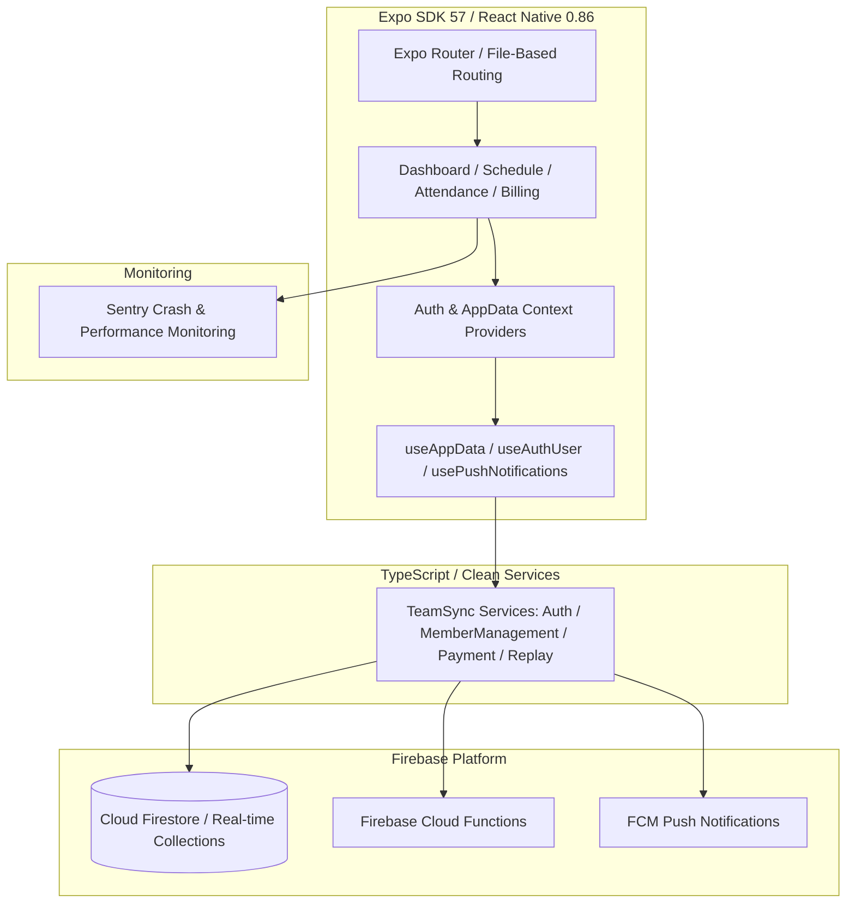

# TeamSync (MaviTeam) — Club & Sports Team Management Platform

[](https://reactnative.dev)
[](https://expo.dev)
[](https://www.typescriptlang.org/)
[](https://firebase.google.com/)
[](https://sentry.io/)
[](LICENSE)

**TeamSync** is an enterprise-grade, cross-platform mobile ecosystem engineered with **React Native (Expo SDK 57)** and **TypeScript** for athletic organizations, sports clubs, coaches, and athletes. It delivers unified club management, event scheduling, attendance tracking, payment gateway integration, and real-time push notifications.

---

## 🌟 Key Capabilities

### 🏆 1. Club Management & Role-Based Access (RBAC)
- Multi-tenant architecture supporting independent clubs, teams, and administrative roles.
- Seamless club creation (`create-club.tsx`), membership request workflows (`join-club.tsx`, `join-request-sent.tsx`), and roster administration.
- Granular permissions for Club Directors, Coaches, Athletes, and Parents.

### 📅 2. Real-Time Scheduling & Attendance Tracking
- **Interactive Calendar & Event Dispatcher:** Comprehensive match, practice, and team event management with dynamic availability checks (`availability.tsx`).
- **Attendance System:** Real-time roll-call and participation tracking (`attendance.tsx`) with historical participation analytics.
- **Club Announcements:** Live bulletin board for team alerts and urgent schedule changes (`announcements.tsx`).

### 💳 3. Subscriptions & Payment Gateway
- Modular payment gateway abstraction (`paymentGatewayService.ts`) for recurring club membership dues, tournament fees, and equipment licensing.
- Promo code validation engine with expiration policies and billing detail modals.

### 🌍 4. Internationalization & Customization
- Built-in multi-language localization (`LanguageProvider`, `expo-localization`) with instant runtime language switching (English & Turkish).
- Adaptive responsive theming (`useResponsive`, `use-theme`) supporting dark/light system color schemes.

### 🔔 5. Push Notifications & Telemetry
- Expo push notifications (`usePushNotificationRegistration.ts`) with custom user notification preference routing.
- Real-time exception tracking and performance telemetry powered by **Sentry** (`@sentry/react-native`).

---

## 🏗️ Architecture & Technical Stack



| Layer | Technologies |
|---|---|
| **Runtime & Framework** | Expo SDK 57 (Hermes Engine), React Native 0.86, React 19.2 |
| **Language** | TypeScript 5.x |
| **Navigation** | Expo Router (Typed File-Based Routing) |
| **Backend & Cloud DB** | Firebase 12 (Authentication, Cloud Firestore, Cloud Storage) |
| **Push Notifications** | Expo Notifications & Firebase Cloud Messaging (FCM) |
| **State & Data Layer** | React Context (`AppDataProvider`, `AuthProvider`), Offline Async Storage |
| **Monitoring & Crash Reporting** | Sentry (`@sentry/react-native`) |
| **UI Components** | React Native Reanimated, Expo UI, Glassmorphism Styling, Tailwind/NativeWind |

---

## 📂 Directory Layout

```
TeamSync/
├── admin-panel/               # Web administration console
├── assets/                    # Branding assets, vector icons, splash screen
├── functions/                 # Firebase Cloud Functions (backend logic & triggers)
├── src/
│   ├── app/                   # Expo Router screens (index, dashboard, schedule, attendance...)
│   ├── components/            # Reusable atomic UI components (Buttons, Drawers, Modals)
│   ├── constants/             # Design tokens, theme palettes, i18n keys
│   ├── hooks/                 # Custom React hooks (useAppData, useAuthUser, usePushNotification)
│   ├── lib/                   # Third-party SDK initializations (Firebase, Sentry)
│   ├── localization/          # Multi-language translation dictionaries (en, tr)
│   ├── providers/             # Global Context Providers (Auth, Language, AppData)
│   ├── services/              # Business logic & Firestore API clients
│   └── types/                 # Shared TypeScript models and schema interfaces
├── package.json
└── tsconfig.json
```

---

## ⚙️ Getting Started

### Prerequisites
- [Node.js](https://nodejs.org/) (v18 or higher recommended)
- [Expo CLI](https://docs.expo.dev/get-started/installation/) (`npx expo`)
- [Expo Go](https://expo.dev/client) app on physical mobile device OR Android/iOS Emulator

### Installation & Run

1. **Clone the repository:**
   ```bash
   git clone https://github.com/Raveloon/MaviTeam-MA-2026.git
   cd MaviTeam-MA-2026/TeamSync
   ```

2. **Install dependencies:**
   ```bash
   npm install
   ```

3. **Start the development server:**
   ```bash
   npx expo start
   ```

4. **Run on Device or Simulator:**
   - Press `a` for Android Emulator.
   - Press `i` for iOS Simulator.
   - Scan the QR code with **Expo Go** on your physical device.

---

## 📄 License

This project is licensed under the [MIT License](LICENSE).
